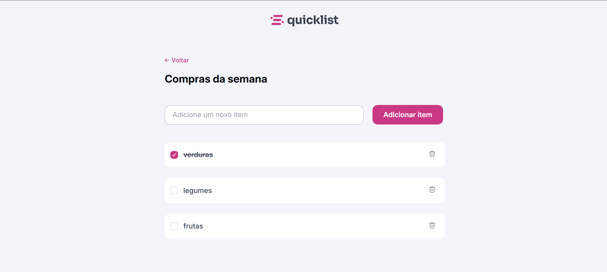

# QuickList - Lista de compras

Este é um projeto simples de lista de compras que fiz para praticar HTML, CSS e JavaScript. A ideia é conseguir anotar os itens que preciso, marcar como concluído e deletar os itens.

## O que dá para fazer

- Adicionar itens à lista.
- Marcar os itens como concluídos. O texto fica riscado quando marcado.
- Remover um item e fechar o aviso que aparece depois da remoção.
- Usar a página em telas menores, como no celular.

## Tecnologias usadas

- HTML para a estrutura da página.
- CSS para o visual e o layout responsivo.
- JavaScript para adicionar, marcar e remover itens.